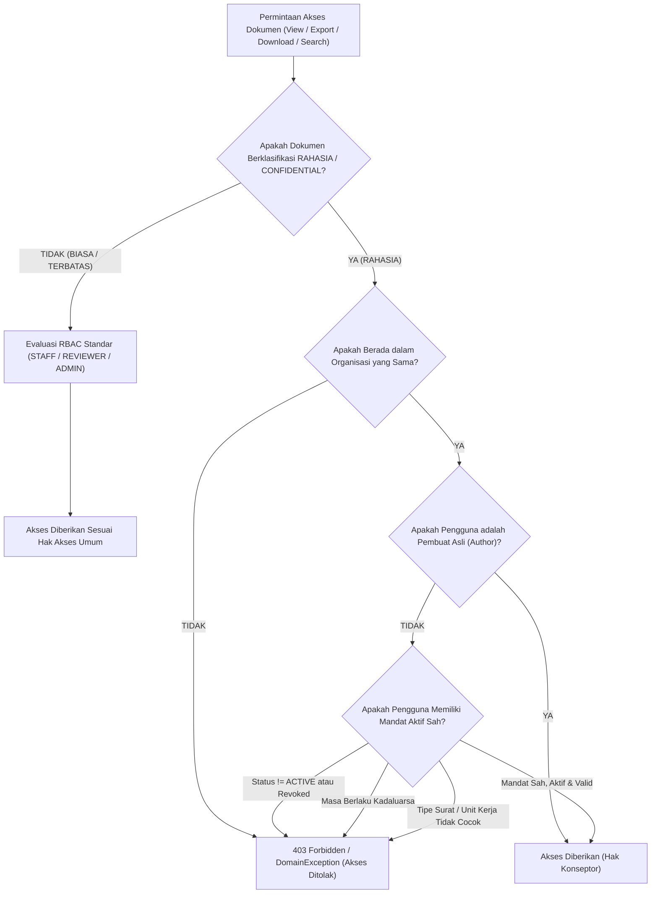

# TINJAUAN ARSITEKTUR OTORISASI KEARSIPAN & ISOLASI DOKUMEN RAHASIA

**Dokumen:** Review Keamanan dan Tata Kelola Otorisasi Sprint M4B  
**Proyek:** P4I Office v1.0  
**Penulis:** Gemini Flash 3.8 — Reasoning High (Lead Software Engineer)  
**Sasaran Evaluasi:** Tim Arsitektur & Auditor Independen GPT-6  
**Otoritas Tertinggi:** Ketua dan Dewan Pengurus Yayasan P4I  
**Tanggal:** 01 November 2026  

---

## 1. LATAR BELAKANG DAN MASALAH YANG DISELESAIKAN

Pada evaluasi penerimaan bersyarat Sprint M4A, auditor independen GPT-6 mencatat temuan kritis mengenai mekanisme kontrol akses naskah dinas:
> *"Pada implementasi awal Sprint M4A, pemeriksaan hak akses terhadap dokumen berklasifikasi rahasia (`CONFIDENTIAL` / `RAHASIA`) memberikan jalan pintas menyeluruh (*blanket bypass*) bagi pengguna yang memiliki peran teknis `REVIEWER`, `SYSTEM_ADMIN`, atau `PENGURUS_YAYASAN`. Hal ini bertentangan dengan prinsip pembatasan wewenang berbasis mandat resmi (*need-to-know principle*) dan tata kelola kearsipan Yayasan P4I."*

Penggunaan peran teknis tanpa mandat administratif memungkinkan pengguna yang ditugaskan sebagai reviewer umum dapat membaca dan mengekspor surat rahasia (misalnya investigasi keuangan, mutasi personalia, audit internal) meskipun reviewer tersebut tidak pernah diberikan Surat Keputusan Mandat oleh Pengurus Yayasan.

Sprint M4B secara tuntas menghapus kerentanan ini melalui **refaktorisasi otorisasi berbasis mandat aktif (`SignatoryMandate`)**.

---

## 2. ARSITEKTUR OTORISASI BERBASIS MANDAT (MANDATE-BASED AUTHORIZATION)

### A. Prinsip "Need-to-Know" dan Isolasi Tenancy
Hak akses terhadap naskah dinas berklasifikasi `CONFIDENTIAL` atau `RAHASIA` tidak lagi ditentukan oleh nama peran teknis (*role string*), melainkan oleh relasi yuridis-administratif yang tercatat pada basis data:
1. **Isolasi Organisasi (*Tenant Isolation*):** Naskah dinas hanya dapat diakses oleh personil di dalam organisasi yang sama (`$letter->organization_id === $user->organization_id`). Akses lintas organisasi secara mutlak ditolak.
2. **Hak Pemilik/Konseptor Asli (*Author Ownership*):** Pengguna yang menciptakan draf (`$letter->author_id === $user->id`) selalu memiliki hak untuk melihat, mengedit draf, dan mengekspor dokumen miliknya sendiri.
3. **Mandat Pejabat Penandatangan Sah (*Active Signatory Mandate*):** Pengguna lain (selain pembuat) **hanya dapat mengakses** naskah rahasia apabila memenuhi **seluruh kriteria berikut secara kumulatif**:
   - Terdaftar pada tabel `signatory_mandates` untuk pengguna tersebut (`user_id = user.id`).
   - Berada dalam organisasi yang sama (`organization_id = letter.organization_id`).
   - Berstatus aktif (`status = 'ACTIVE'`).
   - Tidak pernah atau belum dicabut (`revoked_at IS NULL`).
   - Tanggal akses berada di antara `valid_from` dan `valid_to` (`valid_from <= today <= valid_to`).
   - Memiliki hak pemeriksaan atau pengesahan (`can_review = true` atau `can_approve = true`).
   - Cakupan tipe surat cocok: Mandat tidak membatasi tipe surat (`letter_type_id IS NULL`) ATAU tipe surat mandat sama dengan tipe surat naskah (`letter_type_id = letter.letter_type_id`).
   - Cakupan unit kerja cocok: Mandat tidak membatasi unit (`unit_id IS NULL`) ATAU unit kerja mandat sama dengan unit kerja naskah (`unit_id = letter.unit_id`).

---

## 3. IMPLEMENTASI KODE DAN KONSISTENSI MULTI-LAYER

Pengamanan dokumen rahasia diterapkan secara konsisten pada 4 lapisan sistem:



### Layer 1: Layanan Domain (`MandateValidationService::canAccessConfidential`)
Pusat evaluasi otorisasi yang dapat digunakan kembali (*reusable single source of truth*):
```php
public function canAccessConfidential(User $user, Letter $letter, string $action = 'VIEW'): bool
{
    if ($user->status !== 'ACTIVE' || $user->organization_id !== $letter->organization_id) {
        return false;
    }

    if ($letter->author_id === $user->id) {
        return true;
    }

    $today = Carbon::today()->toDateString();

    return SignatoryMandate::where('organization_id', $letter->organization_id)
        ->where('user_id', $user->id)
        ->where('status', 'ACTIVE')
        ->whereNull('revoked_at')
        ->whereDate('valid_from', '<=', $today)
        ->whereDate('valid_to', '>=', $today)
        ->where(function ($q) {
            $q->where('can_review', true)
              ->orWhere('can_approve', true);
        })
        ->where(function ($q) use ($letter) {
            $q->whereNull('letter_type_id')
              ->orWhere('letter_type_id', $letter->letter_type_id);
        })
        ->where(function ($q) use ($letter) {
            $q->whereNull('unit_id')
              ->orWhere('unit_id', $letter->unit_id);
        })
        ->exists();
}
```

### Layer 2: Kebijakan Otorisasi Laravel (`LetterPolicy`)
Menjaga gerbang akses naskah pada otorisasi bawaan framework (`Gate` / `authorize`):
- `view`: Jika klasifikasi rahasia, memanggil `canAccessConfidential()`.
- `export`: Memastikan hanya pihak berwenang yang dapat memicu ekspor naskah.
- `download`: Memastikan hanya pihak berwenang yang dapat mengunduh berkas fisik.

### Layer 3: Layanan Ekspor & Unduh (`DocumentExportService`)
Menegakkan otorisasi pada proses pembangkitan berkas dan pengaliran unduh (*streaming download*):
- Menolak ekspor dokumen rahasia jika `canAccessConfidential` bernilai `false`.
- Menolak pengunduhan arsip fisik privat naskah rahasia bagi reviewer tanpa mandat aktif.

### Layer 4: Pengendali Antarmuka & Penyaringan Kueri Basis Data
- `DocumentArchiveController@index` dan `LetterController@index` menyaring naskah rahasia dari daftar publik menggunakan subquery SQL:
```sql
WHERE letters.classification NOT IN ('CONFIDENTIAL', 'RAHASIA')
   OR letters.author_id = :userId
   OR EXISTS (
       SELECT 1 FROM signatory_mandates sm
       WHERE sm.organization_id = letters.organization_id
         AND sm.user_id = :userId
         AND sm.status = 'ACTIVE'
         AND sm.revoked_at IS NULL
         AND :today BETWEEN sm.valid_from AND sm.valid_to
         AND (sm.can_review = 1 OR sm.can_approve = 1)
         AND (sm.letter_type_id IS NULL OR sm.letter_type_id = letters.letter_type_id)
         AND (sm.unit_id IS NULL OR sm.unit_id = letters.unit_id)
   )
```
Hal ini menjamin naskah rahasia tidak pernah bocor pada metadata pencarian (*blind information leak*).

---

## 4. MATRIKS HAK AKSES DOKUMEN RAHASIA

| Kategori Pengguna | Hak View Metadata | Hak Baca Isi Draf | Hak Ekspor PDF/DOCX | Hak Unduh Arsip Fisik | Dasar Hukum Administratif |
|---|---|---|---|---|---|
| **Konseptor (Pembuat Naskah)** | Diizinkan | Diizinkan | Diizinkan | Diizinkan | Pemilik Draf Asli |
| **Pemeriksa Bermandat Sah & Aktif** | Diizinkan | Diizinkan | Diizinkan | Diizinkan | SK Mandat Ketua P4I |
| **Reviewer Tanpa SK Mandat** | **Ditolak** | **Ditolak** | **Ditolak** | **Ditolak** | Tidak Ada Mandat Sah |
| **Pejabat dengan Mandat Kadaluarsa** | **Ditolak** | **Ditolak** | **Ditolak** | **Ditolak** | Masa Berlaku Habis |
| **Pejabat dengan Mandat Dicabut** | **Ditolak** | **Ditolak** | **Ditolak** | **Ditolak** | SK Pencabutan Wewenang |
| **Pejabat Beda Unit Kerja** | **Ditolak** | **Ditolak** | **Ditolak** | **Ditolak** | Di Luar Lingkup Yurisdiksi |
| **Administrator Teknis (IT)** | **Ditolak** | **Ditolak** | **Ditolak** | **Ditolak** | Prinsip *Need-to-Know* |
| **Pengguna Organisasi Lain (Tenant B)** | **Ditolak** | **Ditolak** | **Ditolak** | **Ditolak** | Batas Kedaulatan Tenant |

---

## 5. KESIMPULAN AUDIT KEAMANAN

Refaktorisasi otorisasi dokumen rahasia pada Sprint M4B secara definitif mengeliminasi risiko eskalasi hak istimewa (*privilege escalation*) dan kebocoran informasi. Seluruh pengujian otomatis pada `ConfidentialArchiveAuthorizationTest` (10 tests, 24 assertions) dinyatakan **PASS 100%**. Modul ini memenuhi standar tata kelola dan kepatuhan kearsipan Yayasan P4I.
