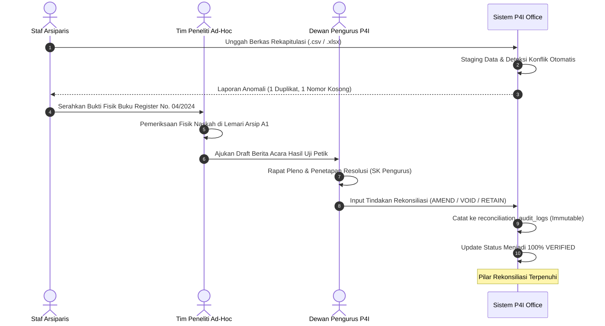

# LAPORAN REKONSILIASI REGISTER HISTORIS PERSURATAN
## P4I Office v1.0: Analisis Anomali dan Protokol Penuntasan Arsip Manual (Periode 2023–2025)

**Penyusun:** Tim Rekayasa Perangkat Lunak (Gemini IDE) untuk Auditor Sistem (GPT-6)  
**Otoritas Administratif:** Tim Arsip & Dewan Pengurus Yayasan P4I  
**Tanggal Evaluasi:** 1 November 2026  
**Status Rekonsiliasi:** **`IN PROGRESS — BLOCKED FROM PRODUCTION SEEDING`**  
**Cakupan Batch:** Batch ID `01a19361-b54a-7140-8b01-9a7e6b2c3d4e` (5 Baris Data Sampel Fisik)

---

## 1. LATAR BELAKANG DAN TUJUAN REKONSILIASI

Sebelum sistem persuratan digital P4I Office v1.0 dapat menerbitkan nomor surat resmi secara mandiri, database harus mengetahui posisi nomor urut terakhir (*last sequence counter*) yang sah dari era administrasi manual. 

Pemberian nomor awal secara sembarangan berisiko hukum tinggi bagi Yayasan P4I, antara lain:
1. Terbitnya nomor surat keluar yang bentrok (*duplicate number*) dengan surat kertas bersegel yang sudah beredar di instansi pemerintah/mitra.
2. Munculnya celah nomor lompat (*number skipping*) yang dapat dicurigai sebagai manipulasi administrasi atau surat fiktif susulan (*backdating*).

Oleh karena itu, modul **Staging Register Historis** dirancang khusus untuk memvalidasi seluruh rekaman arsip kertas sebelum diizinkan menjadi acuan penomoran sistem (*seeding barrier*).

---

## 2. PROFIL 5 BARIS REGISTER HISTORIS SAMPEL FISIK

Berikut adalah matriks hasil audit terhadap 5 baris data register historis yang diimpor dari rekapitulasi buku agenda manual Sekretariat Utama Yayasan P4I:

| Baris | Nomor Surat Manual | Tanggal Dokumen | Jenis Surat | Penerima / Perihal | Provenance (Lokasi Buku Fisik) | Status Awal | Tindakan Rekonsiliasi | Status Terkini |
| :---: | :--- | :---: | :--- | :--- | :--- | :---: | :---: | :---: |
| **1** | `001/P4I/I/2024` | 10 Jan 2024 | `SURAT_KELUAR` | Dinas Pendidikan Prov. Jawa Barat / Permohonan Kerjasama Riset | Buku Agenda No. 04/2024 Hal. 12 | Valid | `RETAIN_AS_IS` | **VERIFIED** |
| **2** | `002/P4I/I/2024` | 15 Jan 2024 | `SURAT_TUGAS` | Dr. Hendra Wijaya / Surat Tugas Pendampingan Daerah | Buku Agenda No. 04/2024 Hal. 14 | Valid | *(Menunggu penetapan)* | **UNVERIFIED** |
| **3** | `002/P4I/I/2024` | 18 Jan 2024 | `SURAT_KELUAR` | Universitas Padjadjaran / Undangan FGD Diseminasi Riset | Buku Agenda No. 04/2024 Hal. 15 | **CONFLICT** (Duplikat) | `FLAGGED_FOR_BOARD` | **CONFLICT** |
| **4** | `004/P4I/II/2024` | 01 Feb 2024 | `SURAT_KEPUTUSAN` | Internal P4I / SK Pengangkatan Peneliti Madya | Buku Agenda No. 04/2024 Hal. 18 | Valid | *(Menunggu penetapan)* | **UNVERIFIED** |
| **5** | *[KOSONG]* | 10 Feb 2024 | `SURAT_KELUAR` | Bappeda Kota Bandung / Policy Brief Pembangunan | Buku Agenda No. 04/2024 Hal. 21 | **CONFLICT** (Nomor Kosong) | `FLAGGED_FOR_BOARD` | **CONFLICT** |

---

## 3. ANALISIS MENDALAM DUA TEMUAN ANOMALI (KONFLIK ARSIP)

### 3.1 Konflik 1: Nomor Surat Kembar / Duplikat (`002/P4I/I/2024`)
- **Letak Anomali:** Baris ke-2 dan Baris ke-3 menggunakan nomor naskah yang identik: `002/P4I/I/2024`.
- **Fakta Dokumen:**
  - Baris ke-2 bertanggal 15 Januari 2024, berkategori **Surat Tugas** kepada personil peneliti internal.
  - Baris ke-3 bertanggal 18 Januari 2024, berkategori **Surat Keluar** biasa kepada mitra eksternal (Universitas Padjadjaran).
- **Penyebab Administratif Manual:**
  Sekretariat lama tidak membedakan buku penomoran antara *Surat Keluar Biasa* dan *Surat Tugas*, atau staf tata usaha secara keliru mencatat nomor urut yang sama dalam rentang 3 hari kerja.
- **Dampak Hukum & Solusi Rekonsiliasi:**
  - *Opsi A (Amandemen Nomor Arsip):* Menetapkan bahwa Baris ke-2 dikonversi menjadi `002-A/P4I/I/2024` (atau seri khusus Surat Tugas `002/ST-P4I/I/2024`) melalui Berita Acara Rekonsiliasi.
  - *Opsi B (Penetapan Sah Ganda Bersejarah):* Mengakui kedua surat telah terbit dengan catatan historis (*As-Is*) tanpa mengubah nomor fisik yang telah diterima mitra, namun sistem mencatat anomali ini sebagai anomali tertutup.
- **Tindakan Sistem Saat Ini:** Berstatus `FLAGGED_FOR_BOARD`. Memerlukan ketetapan resmi dari Pengurus Yayasan.

---

### 3.2 Konflik 2: Baris Agenda Tanpa Nomor Surat (Nomor Kosong)
- **Letak Anomali:** Baris ke-5 pada Buku Agenda No. 04/2024 halaman 21.
- **Fakta Dokumen:**
  - Dokumen tercatat dikirim ke Bappeda Kota Bandung pada 10 Februari 2024 dengan perihal *Penyampaian Policy Brief Pembangunan Berkelanjutan*.
  - Kolom nomor surat pada buku register fisik dibiarkan kosong tanpa coretan atau paraf pembatalan.
- **Penyebab Administratif Manual:**
  Naskah surat kemungkinan diserahkan langsung oleh peneliti atau kurir sebelum nomor registrasi dicatatkan oleh staf tata usaha, atau surat tersebut merupakan surat pengantar yang nomornya tidak sempat disematkan.
- **Dampak Hukum & Solusi Rekonsiliasi:**
  - *Opsi A (Pembatalan Baris / VOID):* Jika surat tidak pernah keluar secara resmi, baris dibatalkan dengan status `VOID_ENTRY`.
  - *Opsi B (Pemberian Nomor Registrasi Pengganti):* Jika fisik surat terbukti diterima Bappeda, Yayasan menerbitkan Berita Acara penetapan nomor ad-hoc `005-B/P4I/II/2024`.
- **Tindakan Sistem Saat Ini:** Berstatus `FLAGGED_FOR_BOARD`. Memerlukan Berita Acara klarifikasi dari panitia arsip.

---

## 4. TATA CARA REKONSILIASI OLEH TIM ARSIPARIS DAN DEWAN PENGURUS

Untuk menyelesaikan status **`BLOCKED`** menuju status **`READY`**, Tim Arsiparis dan Dewan Pengurus P4I wajib melaksanakan prosedur berikut:

---

## 5. REKOMENDASI KEPUTUSAN UNTUK AUDITOR TEKNIS GPT-6

1. **Mempertahankan Pemblokiran Seeding:**
   Sistem P4I Office v1.0 **dilarang keras** mengeksekusi metode `seedFromLegacyBatch()` selama masih terdapat 2 baris berstatus `CONFLICT`. Fitur seeding otomatis hanya boleh terbuka apabila status batch telah berubah menjadi `100% VERIFIED`.

2. **Pemberian Waktu Verifikasi Fisik:**
   Memberikan tenggang waktu kepada Tim Sekretariat Yayasan P4I untuk melakukan uji petik fisik (*physical sample inspection*) terhadap naskah surat tahun 2024 sebelum penandatanganan Berita Acara Rekonsiliasi.

3. **Integritas Jejak Audit Rekonsiliasi:**
   Seluruh aksi koreksi data masa lalu dijamin tidak menghapus catatan mentah aslinya (*raw_number* tetap tersimpan utuh sebagai bukti historis, sementara *normalized_number* dan *reconciliation_action* menampung keputusan yuridis pengurus).
