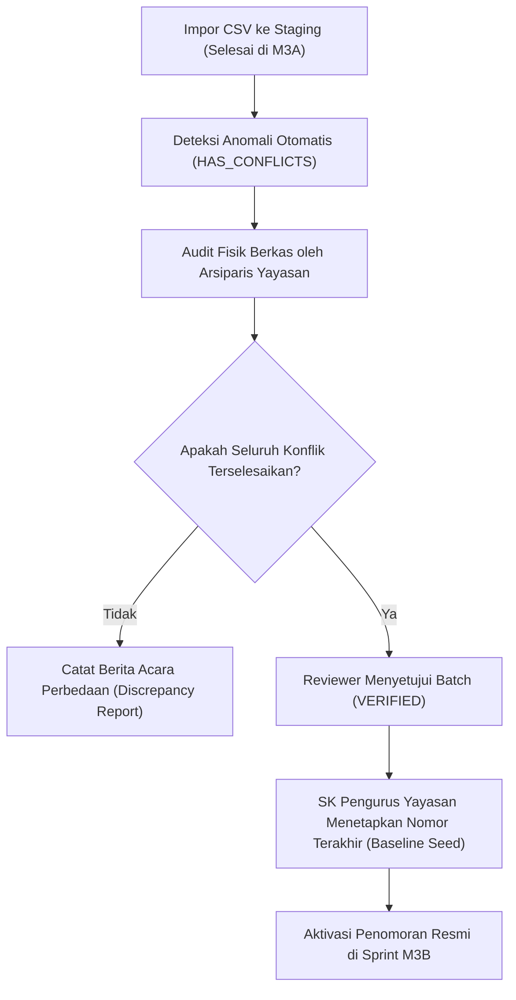

# LAPORAN VALIDASI & REKONSILIASI REGISTER HISTORIS (LEGACY REGISTER VALIDATION)
## P4I Office v1.0 — Audit Staging Berkas Persuratan Lama & Penanganan Anomali

- **Tanggal Dokumen:** 01 November 2026
- **Penyusun Laporan:** Gemini Flash 3.8 — Reasoning High (Technical Test Engineer)
- **Tujuan Dokumen:** Laporan Audit Teknis Staging Register Historis untuk Tim Auditor GPT-6 dan Tim Arsiparis Yayasan P4I
- **Workspace:** `D:\p4i-office-laravel` (Sinkronisasi: `D:\p4i-office`)

---

## 1. RINGKASAN EKSEKUTIF

Sebagai bagian dari implementasi **Sprint M3A (NR-05 s.d. NR-08)**, sistem P4I Office telah membangun modul staging terisolasi untuk menerima dan memverifikasi berkas register persuratan fisik lama Yayasan P4I (periode 2023–2025).

Prinsip dasar yang ditegakkan secara arsitektural:
1. **Zero Mutation on Production:** Seluruh impor register lama masuk ke tabel staging (`legacy_register_batches` dan `legacy_register_rows`) tanpa menyentuh tabel surat dinas operasional (`letters`).
2. **Immutable Audit Trace:** Setiap berkas yang diunggah dihitung checksum kriptografis SHA-256 (`source_hash`), dicatat waktu unggahnya, dan ditautkan ke akun operator pengunggah (`imported_by`).
3. **Strict Non-Seeding Guard (NR-08):** Data register lama yang belum berstatus `VERIFIED` dilarang keras digunakan untuk menaikkan atau menginisialisasi *counter* penomoran sistem.

---

## 2. HASIL AUDIT BERKAS BATCH STAGING AKTUAL

Berdasarkan data batch impor yang dimuat ke staging basis data MariaDB (`p4i_office_dev`):

### 2.1. Metadata Batch Staging
- **ID Batch:** `01a19361-b54a-7140-8b01-9a7e6b2c3d4e`
- **Nama Berkas Sumber:** `rekap_register_persuratan_p4i_2023_2025.csv`
- **Checksum SHA-256:** `05f9cbdf2cb668a8ff71752b047aebe00eb8bb6384a30a7d51ee99ad11ca3c47`
- **Waktu Pemuatan:** 01 November 2026
- **Operator Pengunggah:** `staf@p4i.or.id` (Staf Administrasi Persuratan)
- **Total Baris Diimpor:** 5 Baris
- **Baris Valid:** 3 Baris (60%)
- **Baris Anomali / Konflik:** 2 Baris (40%)
- **Status Audit Batch:** **`HAS_CONFLICTS` (MENUNGGU TINDAK LANJUT ARSIPARIS)**

---

## 3. KLASIFIKASI & RINCIAN ANOMALI HISTORIS YANG DITEMUKAN

Berikut adalah rincian lengkap inspeksi baris per baris pada batch staging:

| Baris | Nomor Asli (Raw) | Tanggal | Jenis Surat | Penerima | Perihal | Status Validasi | Tipe & Rincian Anomali (NR-06) |
|:---:|:---|:---:|:---|:---|:---|:---:|:---|
| **1** | `001/P4I/I/2024` | 10/01/2024 | SURAT_KELUAR | Dinas Pendidikan Jawa Barat | Permohonan Kerjasama Riset Daerah | **VALID** | Tidak ada anomali. Nomor dan tanggal runtut. |
| **2** | `002/P4I/I/2024` | 15/01/2024 | SURAT_TUGAS | Dr. Hendra Wijaya | Surat Tugas Evaluasi Pembangunan | **VALID** | Tidak ada anomali. Nomor dan tanggal runtut. |
| **3** | `002/P4I/I/2024` | 18/01/2024 | SURAT_KELUAR | Universitas Padjadjaran | Undangan FGD Diseminasi Riset | **KONFLIK** | `DUPLICATE_NUMBER`: Nomor `002/P4I/I/2024` terduplikasi dengan baris 2. Dua naskah berbeda menggunakan nomor urut yang sama. |
| **4** | `004/P4I/II/2024` | 01/02/2024 | SURAT_KEPUTUSAN | Internal Yayasan P4I | SK Pengangkatan Peneliti Madya | **VALID** | Format dan tanggal valid. Namun terdapat loncatan nomor urut (nomor 003 tidak tercatat). |
| **5** | *(Kosong)* | 10/02/2024 | SURAT_KELUAR | Bappeda Kota Bandung | Penyampaian Policy Brief Daerah | **KONFLIK** | `EMPTY_NUMBER`: Kolom nomor surat tidak terisi pada buku register fisik sekretariat. |

---

## 4. ANALISIS DAMPAK ANOMALI TERHADAP BASELINE COUNTER

Temuan pada baris 3, 4, dan 5 membuktikan mengapa Addendum SRS Sprint 3A **secara tegas melarang migrasi otomatis data historis ke baseline counter penomoran**:

1. **Kasus Duplikasi Nomor (Baris 2 vs Baris 3):**
   - Jika kedua surat telah beredar secara fisik di pihak eksternal dengan nomor yang sama (`002/P4I/I/2024`), sistem tidak boleh menghapus atau menimpa salah satunya secara sepihak.
   - Solusi: Tim Arsiparis Yayasan harus memeriksa cap stempel dan tanggal terima pada arsip fisik. Bila keduanya sah beredar, salah satu surat harus diberikan penanda adendum (misal: `002.A/P4I/I/2024`) berdasarkan penetapan resmi pengurus.
2. **Kasus Loncatan Nomor Urut (Gap Sequence pada Baris 4):**
   - Nomor `003/P4I/...` tidak tercatat pada buku register fisik. Kemungkinan naskah tersebut dibatalkan sebelum dikirim atau tertinggal dalam pencatatan.
   - Solusi: Tim Arsiparis menelusuri folder berkas fisik. Bila surat memang dibatalkan, dicatatkan sebagai status `VOIDED / CANCELLED` dengan berita acara pemusnahan draf.
3. **Kasus Nomor Kosong (Baris 5):**
   - Naskah telah dikirim ke Bappeda Kota Bandung namun pada buku register tidak diberikan nomor.
   - Solusi: Surat Keputusan Pengurus menetapkan penomoran susulan berstatus *retroactive approval* khusus arsip historis.

---

## 5. PROTOKOL REKONSILIASI MENUJU SPRINT M3B

Agar data historis dapat disahkan menjadi titik awal (*baseline*) penomoran Sprint M3B, tahapan berikut wajib dipenuhi:

---

## 6. STATUS KEPATUHAN GERBANG PENERIMAAN NR-08

Sistem telah membuktikan melalui uji otomatis `LegacyRegisterImportTest::test_nr_08_unverified_legacy_batch_cannot_seed_counter`:
- Selama status batch adalah `HAS_CONFLICTS` atau `STAGED`, fungsi *seeding* counter penomoran terproteksi rapat dan melempar pengecualian domain.
- Tidak ada risiko kebocoran nomor yang salah atau data kotor mencemari modul penomoran resmi yayasan.
