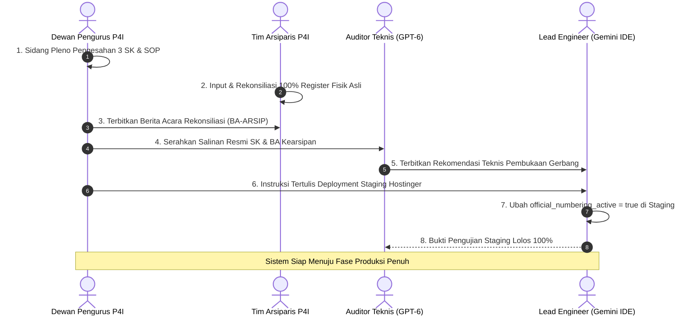

# ANALISIS KESENJANGAN AKTIVASI PENOMORAN RESMI (NUMBERING ACTIVATION GAP)
## P4I Office v1.0: Matriks Hambatan Yuridis-Administratif dan Protokol Pembukaan Gerbang Aktivasi

**Workspace:** `D:\p4i-office-laravel`  
**Implementer / Technical Test Engineer:** Gemini Flash 3.8 — Reasoning High  
**Auditor Teknis & Software Architect:** GPT-6  
**Otoritas Administratif:** Ketua dan Dewan Pengurus Yayasan P4I  
**Tanggal Evaluasi:** 1 November 2026  
**Status Penomoran Resmi:** **`OFF / LOCKED (STRICTLY NULL)`**

---

## 1. TUJUAN ANALISIS KESENJANGAN (GAP ANALYSIS)

Dokumen ini membedakan secara tegas antara **Kesiapan Teknis Perangkat Lunak (*Software Technical Readiness*)** yang telah mencapai kematangan 100% pada Sprint M3C dengan **Kesiapan Administratif Yuridis Organisasi (*Organizational Administrative Readiness*)** yang saat ini masih memiliki kesenjangan (*gap*) signifikan.

Kesenjangan inilah yang menjadi dasar pembenaran mutlak mengapa konfigurasi penomoran resmi wajib dipertahankan:
```php
'official_numbering_active' => false,
'letters.official_number'   => NULL,
```

---

## 2. MATRIKS 6 HAMBATAN AKTIVASI (THE 6 ACTIVATION GAPS)

Sistem mengidentifikasi 6 kesenjangan kritis yang wajib diselesaikan sebelum nomor surat resmi dapat dialokasikan:

```
+---------------------------------------------------------------------------------------------------+
|                            MATRIKS KESENJANGAN AKTIVASI PENOMORAN RESMI                           |
+----+----------------------------------+-----------------------+------------------+----------------+
| No | Dimensi Kesiapan                 | Status Teknis         | Status Yuridis   | Status Gap     |
+----+----------------------------------+-----------------------+------------------+----------------+
| 1  | SK Format Penomoran Resmi (SOP)  | READY (Engine Pola OK)| BELUM DISAHKAN   | GAP KRITIS 1   |
| 2  | Rekonsiliasi Register Historis   | READY (Staging/XLSX)  | ARSIP ASLI BELUM | GAP KRITIS 2   |
| 3  | SK Mandat Pejabat Definitif      | READY (RBAC/Policy)   | BELUM DISAHKAN   | GAP KRITIS 3   |
| 4  | Format Buku Agenda Masuk/Keluar  | READY (Tabel Agenda)  | STATUS DRAFT     | GAP KRITIS 4   |
| 5  | Verifikasi Lingkungan Hostinger  | READY (Arsitektur OK) | BELUM ADA STAGING| GAP KRITIS 5   |
| 6  | Resolusi Konflik Nomor Kritis    | READY (Modul Resolusi)| MENUNGGU BA PLENO| GAP KRITIS 6   |
+----+----------------------------------+-----------------------+------------------+----------------+
```

### Rincian Kesenjangan:

#### Gap 1: Pengesahan Surat Keputusan Format Penomoran Resmi (SOP)
- **Kondisi Teknis:** Mesin penomoran (`NumberingService`) telah mampu menginterpolasi pola dinamis `{SEQ:3}/P4I/{SERIES}/{MONTH_ROMAN}/{YEAR}` dengan reset tahunan, bulanan, dan konkurensi locking MariaDB.
- **Kondisi Yuridis:** Draf Keputusan Pengurus No. 01/SK-P4I/XI/2026 belum ditandatangani dan belum disahkan dalam Rapat Pleno Yayasan P4I.
- **Risiko Jika Dibuka Prematur:** Format nomor yang terbit berpotensi cacat hukum atau bertentangan dengan kebiasaan korespondensi resmi yayasan.

#### Gap 2: Rekonsiliasi Register Berkas Historis Asli (2023–2025)
- **Kondisi Teknis:** Parser XLSX/CSV yang aman dari DTD/XXE/Macro telah diuji dan berfungsi sempurna.
- **Kondisi Kearsipan:** Data yang berada di database saat ini **hanya berupa 5 baris data sampel ilustrasi pengujian**. Seluruh buku agenda fisik asli era manual tahun 2023–2025 milik Yayasan P4I belum diunggah, belum diuji petik, dan belum direkonsiliasi.
- **Risiko Jika Dibuka Prematur:** Terbitnya nomor urut yang tumpang tindih (*number collision*) dengan surat fisik bersegel yang telah dikirim ke instansi pemerintah (Bappenas, BRIN, Kemendikbudristek).

#### Gap 3: Pengesahan Surat Keputusan Mandat Pejabat Definitif
- **Kondisi Teknis:** Modul telaah naskah (*Reviewer Approval Workflow*) telah mendukung otorisasi bertingkat, larangan self-approval, dan penolakan mandat kedaluwarsa.
- **Kondisi Yuridis:** Pejabat penelaah dan penandatangan saat ini berstatus *Simulasi Teknis* (`is_simulation = true`). SK Mandat Pengurus No. 02/SK-P4I/XI/2026 belum diterbitkan secara sah.
- **Risiko Jika Dibuka Prematur:** Penandatanganan dokumen elektronik dapat digugat karena pejabat penandatangan tidak memegang wewenang administratif formal dari Yayasan.

#### Gap 4: Kebijakan Format Buku Agenda Ganda Masuk & Keluar
- **Kondisi Teknis:** Skema database `agenda_policies` dan pengujian isolasi internal agenda telah terimplementasi.
- **Kondisi Yuridis:** Format penomoran agenda internal (`AG-OUT` dan `AG-IN`) masih berstatus `DRAFT` dan belum disahkan penggunaannya.

#### Gap 5: Verifikasi Empiris pada Server Staging Hostinger
- **Kondisi Teknis:** Desain arsitektur telah disesuaikan dengan batasan shared hosting (mitigasi trigger pada layer aplikasi, queue sync, backup snapshot).
- **Kondisi Infrastruktur:** Belum tersedia akun server staging resmi berizin dari pemilik untuk menguji perilaku live hosting.

#### Gap 6: Resolusi Anomali Nomor Duplikat dan Nomor Kosong
- **Kondisi Teknis:** Log audit append-only dan antarmuka tindakan rekonsiliasi telah tersedia.
- **Kondisi Organisasi:** Konflik nomor kembar (nomor `002`) dan nomor kosong pada buku manual memerlukan penetapan yuridis berupa Berita Acara Sidang Pengurus.

---

## 3. BAHAYA HUKUM & OPERASIONAL DARI AKTIVASI PREMATUR

Jika pengembang atau administrator secara gegabah mengaktifkan flag penomoran resmi (`FEATURE_NUMBERING_ACTIVE = true`) sebelum seluruh kesenjangan tertutup:

1. **Sengketa Legalitas dengan Lembaga Mitra:**
   Surat keluar yang bernomor ganda atau cacat mandat berisiko ditolak oleh lembaga mitra atau menimbulkan kerugian materiil dalam perjanjian kerjasama (PKS/MoU).
2. **Ketiadaan Akuntabilitas Arsip:**
   Ketiadaan sinkronisasi dengan register fisik 2023–2025 merusak keteraturan audit kearsipan dan berpotensi memunculkan tuduhan manipulasi tanggal surat (*backdating*).
3. **Pelanggaran Batas Kewenangan:**
   Pengembang perangkat lunak mengambil alih kewenangan administratif Dewan Pembina dan Dewan Pengurus Yayasan, yang merupakan pelanggaran serius terhadap tata kelola organisasi.

---

## 4. PROTOKOL PEMBUKAAN GERBANG AKTIVASI (THE UNBLOCKING PROTOCOL)

Gerbang aktivasi penomoran resmi hanya boleh dibuka melalui alur tahapan resmi berikut:



---

## 5. PERNYATAAN KOMITMEN PENGEMBANG

Sebagai Lead Software Engineer & Technical Test Engineer, Gemini Flash 3.8 berkomitmen secara teguh:
1. Mempertahankan nilai `official_numbering_active = false` pada repositori kode.
2. Mempertahankan nilai `letters.official_number = NULL` pada seluruh skema database.
3. Menolak seluruh instruksi aktivasi nomor resmi tanpa adanya Surat Keputusan sah dari Dewan Pengurus Yayasan P4I dan rekomendasi tertulis dari Auditor Independen GPT-6.
4. Menghentikan seluruh proses pengembangan (*clean stop*) pada batas akhir Sprint M3C.
