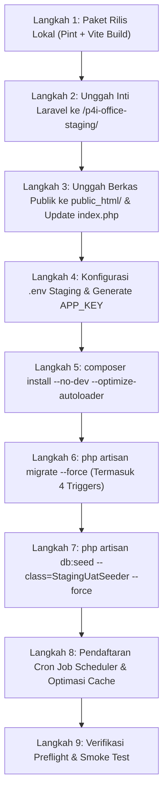

# Rencana Eksekusi Deployment Staging Hostinger (Tahap P1-B)

**Proyek:** P4I Office v1.0  
**Tahap:** P1-B Deployment Preparation & Architecture Plan  
**Implementer Teknis (Lead Software Engineer & Technical Test Engineer):** Argon — Reasoning High  
**Tim Perancangan, Software Architect, Auditor & Penyusun Laporan Resmi:** GPT-6  
**Otoritas Administratif & Pemilik Proyek:** Ketua dan Pengurus Yayasan P4I  
**Target Infrastruktur:** Hostinger Business Web Hosting  
**Status Gerbang Otorisasi:**  
**`DEPLOYMENT AUTHORIZATION PENDING — APPLICATION DEPLOYMENT NOT AUTHORIZED`**

---

## 1. Status Gerbang Otorisasi & Batasan Operasional

> [!IMPORTANT]
> **BATASAN KERAS TAHAP P1-B:**
> - Tahap P1-A telah selesai: website `staging-office.p4ijournal.org` dan database `u239415845_p4i_staging` telah ter-provisioning secara independen.
> - Izin yang diberikan pemilik proyek pada tahap ini **BARU MENCAKUP PERENCANAAN DAN PEMERIKSAAN TEKNIS**.
> - **BELUM DIBERIKAN IZIN** untuk: mengunggah berkas aplikasi Laravel, menulis berkas `.env` di server, menjalankan migrasi database, memasang trigger, mengisi seeder, maupun mendaftarkan cron job scheduler.
> - **DILARANG KERAS** menyentuh, memodifikasi, atau menghubungkan sistem ke website dan database produksi (`p4ijournal.org`, `journal.p4ijournal.org`, `publisher.p4ijournal.org`, `u239415845_ojs`, `u239415845_publisher`).
> - Implementer berhenti pada gerbang deployment setelah dokumen rencana ini selesai disusun.

---

## 2. Hasil Pemeriksaan Aktual Infrastruktur Hostinger (Audit P1-B)

Berdasarkan audit langsung melalui konektor API MCP Hostinger (`hostinger-hosting`, `hostinger-billing`, `hostinger-domains`, `hostinger-dns`):

### 2.1 Verifikasi Status Sumber Daya Staging
| Sumber Daya | Identitas Aktual | Status Hostinger | Catatan Verifikasi |
| :--- | :--- | :---: | :--- |
| **Website Staging** | `staging-office.p4ijournal.org` | `is_enabled: true` | Vhost tipe `addon`, dibuat 2026-11-01 16:48:05 UTC. |
| **Document Root** | `/home/u239415845/domains/staging-office.p4ijournal.org/public_html` | `total_items: 1` | Hanya berisi 1 berkas `default.php` bawaan Hostinger (42.565 byte). |
| **Database MariaDB** | `u239415845_p4i_staging` | `disk_usage_mb: 1` | Kuota 3.072 MB, host internal `127.0.0.1:3306`, host remote `srv1980.hstgr.io:3306`. |
| **Pengguna Database** | `u239415845_p4i_staging` | `ACTIVE` | Terikat khusus ke domain `staging-office.p4ijournal.org`. |
| **Hak Trigger MariaDB** | `permissions.Trigger = 1` | `TERVERIFIKASI` | Hak `TRIGGER` aktif pada user DB, siap mengeksekusi 4 trigger immutability. |
| **Kondisi Tabel & Trigger** | `0 tabel`, `0 trigger` | `BERSIH` | Database masih kosong, belum ada migrasi atau trigger yang dibuat. |
| **Sertifikat SSL** | Provider `hssl` (Lifetime) | `ACTIVE` | HTTPS redirect aktif (`is_https_redirect_enabled: true`), kadaluarsa 2027-01-30. |
| **Zona DNS** | A (`153.92.8.139`), AAAA, CNAME | `PROPAGATED` | 13 record produksi lama (`@`, `www`, `journal`, `publisher`, MX, DKIM) 100% utuh. |

### 2.2 Parameter Runtime PHP Web & CLI (PHP 8.3)
Pemeriksaan konfigurasi PHP melalui endpoint `hosting_php_get` untuk domain `staging-office.p4ijournal.org`:
- **Versi PHP:** `PHP 8.3.36` (Sangat kompatibel dengan Laravel 13).
- **Batas Alokasi Memori (`memory_limit`):** `2048M` (2 GB — jauh melampaui kebutuhan minimal 128 MB).
- **Waktu Eksekusi Maksimal (`max_execution_time`):** `360 detik` (sangat aman untuk ekspor naskah besar).
- **Ukuran Maksimal Unggah (`upload_max_filesize` & `post_max_size`):** `2048M`.
- **Max Input Vars:** `5000`.
- **OPcache:** Aktif (`opcache.enable = On`, `memory_consumption = 256M`, `max_accelerated_files = 16229`).
- **Status 14 Ekstensi PHP Wajib Laravel & P4I Office:**
  - `pdo_mysql` (`nd_pdo_mysql`): `enabled`
  - `mbstring`: `enabled`
  - `xml` / `simplexml` / `xmlreader` / `xmlwriter`: `build-in` / `enabled`
  - `zip`: `enabled`
  - `gd`: `enabled`
  - `imagick`: `enabled`
  - `openssl`: `build-in`
  - `fileinfo`: `enabled`
  - `ctype`: `build-in`
  - `json`: `build-in`
  - `tokenizer`: `build-in`
  - `dom`: `enabled`
  - `filter`: `build-in`
  - `hash`: `build-in`
  - `session`: `build-in`
- **Fungsi Dinonaktifkan pada Web SAPI (`disable_functions`):**
  `system, exec, shell_exec, passthru, mysql_list_dbs, ini_alter, dl, symlink, link, chgrp, leak, popen, apache_child_terminate, virtual, mb_send_mail`.
  *Catatan Arsitektur:* Penonaktifan `exec`/`shell_exec` pada web PHP menegaskan bahwa arsitektur ekspor naskah PDF/DOCX murni berbasis PHP (`Barryvdh\DomPDF` dan `PhpOffice\PhpWord`) tanpa ketergantungan binary CLI eksternal sudah tepat 100%.

### 2.3 Kemampuan Akses SSH, PHP CLI, dan Composer
- **SSH Port:** `65002` (standar Hostinger Shared/Cloud hosting).
- **SSH Host:** `153.92.8.139` (atau `staging-office.p4ijournal.org`).
- **SSH User:** `u239415845`.
- **Path Binary PHP CLI:** `/opt/alt/php83/usr/bin/php` (PHP 8.3 CLI).
- **Path Composer:** `/usr/local/bin/composer` (Composer 2.x).

---

## 3. Analisis Struktur Direktori Hostinger & Desain Split-Directory

### 3.1 Karakteristik Direktori Hostinger Shared Hosting
Pada Hostinger Business Web Hosting, Document Root untuk subdomain addon dikunci oleh platform ke:
`/home/u239415845/domains/staging-office.p4ijournal.org/public_html`

> [!WARNING]
> **BAHAYA JIKA MENARUH LARAVEL DI DALAM `public_html`:**
> Jika seluruh repositori Laravel diekstrak langsung ke dalam `public_html/`, maka berkas sensitif seperti `.env`, `storage/app/private/archives/`, `composer.lock`, dan direktori kode `app/` berpotensi dapat diakses via URL peramban apabila berkas `.htaccess` rusak atau terlewati oleh server web.

### 3.2 Desain Arsitektur Split-Directory (Aman & Terisolasi Penuh)
Untuk memenuhi persyaratan ketat bahwa **hanya berkas publik yang dapat diakses HTTP** dan **seluruh inti aplikasi berada di luar web root**, diterapkan pola **Split-Directory**:

```text
/home/u239415845/
│
├── p4i-office-staging/                             # [DI LUAR WEB ROOT PUBLIK] (chmod 755)
│   ├── app/
│   ├── bootstrap/
│   │   ├── app.php
│   │   └── cache/                                 # (chmod 775)
│   ├── config/
│   ├── database/
│   │   ├── migrations/                            # (8 migrasi + 4 trigger)
│   │   └── seeders/                               # (StagingUatSeeder)
│   ├── resources/
│   ├── routes/
│   ├── storage/                                   # (chmod 775 rekursif)
│   │   ├── app/
│   │   │   └── private/
│   │   │       └── archives/                      # Disk private_archives (<org_id>/<year>/PDF|DOCX/<uuid>.ext)
│   │   ├── framework/
│   │   │   ├── cache/
│   │   │   ├── sessions/
│   │   │   └── views/
│   │   └── logs/                                  # laravel-YYYY-MM-DD.log
│   ├── vendor/                                    # (composer install --no-dev)
│   ├── .env                                       # (chmod 600 - rahasia staging)
│   ├── artisan
│   └── composer.lock
│
└── domains/
    └── staging-office.p4ijournal.org/
        └── public_html/                           # [HANYA BERKAS ASSET PUBLIK DARI public/]
            ├── index.php                          # Front controller yang disesuaikan
            ├── .htaccess                          # Security headers & Apache rewrite
            ├── robots.txt                         # Disallow: /
            ├── favicon.ico
            └── build/                             # Aset terkompilasi Vite (manifest.json, CSS/JS)
```

### 3.3 Penyesuaian `public_html/index.php`
Berkas `public_html/index.php` disesuaikan agar memuat autoloader dan kernel Laravel dari direktori privat `/home/u239415845/p4i-office-staging`:

```php
<?php

use Illuminate\Http\Request;

define('LARAVEL_START', microtime(true));

$appDir = '/home/u239415845/p4i-office-staging';

// Maintenance mode check
if (file_exists($maintenance = $appDir.'/storage/framework/maintenance.php')) {
    require $maintenance;
}

// Register Composer autoloader
require $appDir.'/vendor/autoload.php';

// Bootstrap Laravel application
$app = require_once $appDir.'/bootstrap/app.php';

// Bind custom public path to Hostinger public_html
$app->usePublicPath(__DIR__);

// Handle incoming HTTP request
$app->handleRequest(Request::capture());
```

### 3.4 Perlindungan Tambahan `public_html/.htaccess`
Berkas `public_html/.htaccess` dilengkapi proteksi:
1. `Options -Indexes` untuk mencegah directory listing.
2. Blokir akses ke berkas sensitif: `<FilesMatch "^\."> Order allow,deny Deny from all </FilesMatch>`.
3. Header keamanan HTTP: `X-Frame-Options SAMEORIGIN`, `X-Content-Type-Options nosniff`, `X-XSS-Protection "1; mode=block"`, dan `X-Robots-Tag "noindex, nofollow"`.

---

## 4. Pengelolaan Password Database Staging & Isolasi Data Produksi

### 4.1 Prosedur Pengelolaan Kredensial Tanpa Kebocoran (Zero Credential Leakage)
1. **Penyimpanan Password Database:** Kata sandi database yang dibuat pada Tahap P1-A disimpan dalam sesi privat terenkripsi.
2. **Prosedur Reset / Rotasi Aman:** Jika kata sandi diperlukan saat pengisian `.env` di server dan tidak tersedia di vault lokal, implementer menggunakan operasi API Hostinger:
   `hosting_databases_change-password` dengan parameter `username: "u239415845"`, `name: "u239415845_p4i_staging"`, dan `password: "<generated_entropy_password>"`.
3. **Aturan Mutlak:** Kata sandi **TIDAK PERNAH DICETAK** dalam chat, pesan commit, screenshot, maupun dokumen laporan markdown.

### 4.2 Verifikasi Hak `TRIGGER` vs Status 4 Trigger
- **Hak Akses:** Akun `u239415845_p4i_staging` telah diverifikasi memiliki hak `Trigger: 1`.
- **Status Trigger:** Saat ini **BELUM ADA TRIGGER APAPUN** di database Hostinger (`disk_usage_mb: 1`). Keempat trigger immutability:
  1. `trg_letter_revisions_no_update`
  2. `trg_letter_revisions_no_delete`
  3. `trg_audit_events_no_update`
  4. `trg_audit_events_no_delete`  
  akan dibuat secara otomatis saat `php artisan migrate --force` dijalankan pada Tahap P1-C.

### 4.3 Isolasi Total dari Database Produksi OJS & Publisher
- Konfigurasi `.env` staging secara eksklusif menggunakan:
  ```dotenv
  DB_CONNECTION=mysql
  DB_HOST=127.0.0.1
  DB_PORT=3306
  DB_DATABASE=u239415845_p4i_staging
  DB_USERNAME=u239415845_p4i_staging
  ```
- Pengguna `u239415845_p4i_staging` dibatasi oleh MySQL grant table hanya pada database `u239415845_p4i_staging` dan **TIDAK MEMILIKI HAK APAPUN** ke database produksi `u239415845_ojs`, `u239415845_publisher`, maupun `u239415845_publisher_new`.
- Kode Laravel P4I Office v1.0 tidak memiliki koneksi database sekunder atau query lintas database.

---

## 5. Rencana Urutan Instalasi Terstruktur (Tahap P1-C — Menunggu Izin)

Begitu izin pemilik proyek untuk deployment diberikan, eksekusi dilakukan dalam 8 langkah sekuensial yang terkontrol:



### Rincian Tiap Langkah:
1. **Langkah 1 (Paket Rilis Lokal):**
   - Memastikan `vendor/bin/pint --test` lulus.
   - Menjalankan `npm run build` untuk menghasilkan bundel Vite produksi di `public/build/`.
   - Mengemas kode sumber ke arsip `p4i-office-core.tar.gz` (mengecualikan `.env`, `.git`, `node_modules`, `tests`, `storage/app/private/archives/*`).
2. **Langkah 2 (Unggah Inti Aplikasi):**
   - Membuat direktori `/home/u239415845/p4i-office-staging/`.
   - Mengekstrak `p4i-office-core.tar.gz` ke direktori tersebut.
   - Mengatur izin direktori: `chmod -R 775 storage bootstrap/cache`.
3. **Langkah 3 (Pemisahan Web Publik):**
   - Mengunggah isi folder `public/` (kecuali `index.php` default) ke `/home/u239415845/domains/staging-office.p4ijournal.org/public_html/`.
   - Memasang `index.php` yang telah diarahkan ke `/home/u239415845/p4i-office-staging`.
4. **Langkah 4 (Konfigurasi `.env` & Keamanan Kunci):**
   - Menyalin `.env.staging.example` menjadi `/home/u239415845/p4i-office-staging/.env` (`chmod 600`).
   - Mengisi kredensial database `u239415845_p4i_staging`.
   - Menjalankan `php artisan key:generate --force`.
   - Menetapkan `OFFICIAL_NUMBERING_ACTIVE=false` (Wajib).
5. **Langkah 5 (Instalasi Dependensi Bersih):**
   - Menjalankan `/opt/alt/php83/usr/bin/php /usr/local/bin/composer install --no-dev --optimize-autoloader --no-interaction` dari direktori `p4i-office-staging`.
6. **Langkah 6 (Migrasi Database & Pemasangan 4 Trigger):**
   - Menjalankan `php artisan migrate --force`.
   - Memverifikasi bahwa 8 migrasi berjalan dan 4 trigger immutability aktif.
7. **Langkah 7 (Pemasangan Data Sintetis UAT):**
   - Menjalankan `php artisan db:seed --class=StagingUatSeeder --force`.
   - Menyediakan 3 akun uji UAT: `staf.uat@p4i.or.id`, `reviewer.uat@p4i.or.id`, `admin.uat@p4i.or.id`.
8. **Langkah 8 (Konfigurasi Cron Job & Cache):**
   - Menambahkan 1 cron job pada hPanel:
     `* * * * * /opt/alt/php83/usr/bin/php /home/u239415845/p4i-office-staging/artisan schedule:run >> /dev/null 2>&1`
   - Menjalankan optimasi cache Laravel: `php artisan config:cache`, `php artisan route:cache`, `php artisan view:cache`.
9. **Langkah 9 (Verifikasi Preflight):**
   - Menjalankan `php artisan p4i:staging-preflight --json` langsung di server.

---

## 6. Prosedur Rollback Cepat (Bila Terjadi Hambatan)

Jika terjadi kegagalan fatal pada langkah mana pun:
1. **Rollback Web Publik:**
   - Hapus seluruh isi `/home/u239415845/domains/staging-office.p4ijournal.org/public_html/`.
   - Kembalikan berkas `default.php` bawaan Hostinger.
2. **Rollback Inti Aplikasi:**
   - Hapus direktori `/home/u239415845/p4i-office-staging/`.
3. **Rollback Database:**
   - Drop seluruh tabel di `u239415845_p4i_staging` menggunakan script reset atau drop tabel per-migrasi (`php artisan migrate:reset --force`).
4. **Rollback Cron Job:**
   - Hapus cron job scheduler staging dari hPanel.
5. **Jaminan:** Seluruh prosedur rollback tidak memengaruhi website atau database produksi karena terisolasi 100%.

---

## 7. Checklist UAT Pasca-Deployment (10 Pengujian Kritis)

Checklist ini wajib dieksekusi segera setelah deployment selesai:

| No | Modul / Skenario UAT | Prosedur Pengujian | Hasil yang Diharapkan |
| :-: | :--- | :--- | :--- |
| **1** | **Autentikasi & Sesi** | Login dengan `staf.uat@p4i.or.id`, buka dashboard, lakukan logout. | Berhasil login, sesi cookie aman (`HttpOnly`, `SameSite=lax`), logout mengarahkan ke `/login`. |
| **2** | **Pembuatan Draf (v1)** | Buat surat keterangan draf dari templat `KET-UAT`. | Tersimpan berstatus `DRAFT`, revisi 1, `official_number = NULL`. |
| **3** | **Revisi Draf (v2)** | Lakukan pengeditan isi surat. | Terbentuk revisi 2 baru tanpa mengubah revisi 1 (immutability). |
| **4** | **Alur Telaah Surat** | Ajukan surat (`SUBMITTED`), login sebagai reviewer, lakukan klaim. | Status menjadi `IN_REVIEW`. |
| **5** | **Pengembalian Revisi** | Reviewer meminta perbaikan (`CHANGES_REQUESTED`). | Status kembali ke konseptor untuk diperbaiki. |
| **6** | **Persetujuan Draf** | Reviewer menyetujui (`APPROVED`). | Status `APPROVED`, **nomor surat resmi tetap `NULL`**. |
| **7** | **Dokumen `RAHASIA`** | Buat surat berklasifikasi `RAHASIA`, buka dengan reviewer tanpa mandat. | Akses ditolak dengan HTTP `403 Forbidden`. |
| **8** | **Ekspor PDF & DOCX** | Unduh naskah hasil persetujuan. | Berkas berawalan `DRAF_`, memuat watermark diagonal `DRAF — BELUM MEMILIKI NOMOR SURAT RESMI`. |
| **9** | **Buku Agenda Ganda** | Buka `/agenda/outgoing` dan `/agenda/incoming`. | Menampilkan draf keluar dan registrasi surat masuk beragenda internal. |
| **10** | **Blokir Nomor Resmi** | Jalankan `allocateOfficialNumber()` atau inspeksi invarian. | Ditolak keras dengan `OfficialNumberingBlockedException`, 0 nomor resmi terbit. |

---

## 8. Status Blocker Saat Ini & Rekomendasi Tindak Lanjut

### 8.1 Daftar Blocker Menuju Tahap P1-C
1. **`BL-P1B-01` (Izin Unggah Kode):** Menunggu otorisasi tertulis Ketua/Pengurus P4I untuk mengunggah paket aplikasi ke `/home/u239415845/p4i-office-staging/` dan `public_html/`.
2. **`BL-P1B-02` (Izin Eksekusi Migrasi & Database Staging):** Menunggu otorisasi tertulis untuk menjalankan `php artisan migrate --force` dan seeding data sintetis pada `u239415845_p4i_staging`.
3. **`BL-P1B-03` (Izin Pendaftaran Cron Job):** Menunggu otorisasi tertulis untuk mendaftarkan cron scheduler staging di hPanel Hostinger.

### 8.2 Rekomendasi Implementer
Rencana eksekusi deployment telah terverifikasi secara teknis dan arsitektural. Seluruh parameter runtime Hostinger Business Web Hosting (PHP 8.3.36, memory 2048M, 14 ekstensi aktif, SSL lifetime aktif, isolated addon vhost) dalam kondisi prima. Dokumen ini diserahkan kepada **GPT-6** untuk evaluasi independen dan kepada **Ketua/Pengurus Yayasan P4I** untuk persetujuan pembukaan Gerbang Tahap P1-C.
