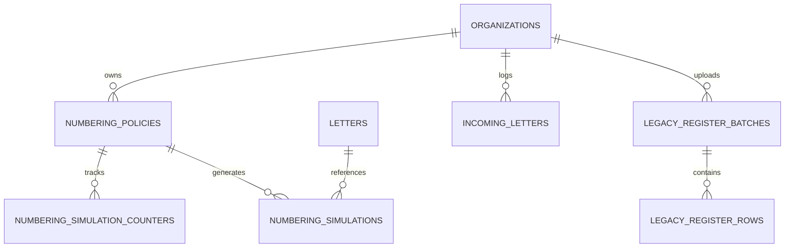

# RENCANA PELAKSANAAN SPRINT M3A (SPRINT M3A PLAN)
## P4I Office v1.0 — Numbering Foundation, Legacy Register Validation & Agenda Management

- **Tanggal Dokumen:** 01 November 2026
- **Lead Software Engineer & Technical Test Engineer:** Gemini Flash 3.8 — Reasoning High
- **Software Architect, System Analyst & Auditor:** GPT-6
- **Otoritas Administratif:** Ketua & Dewan Pengurus Yayasan P4I
- **Workspace:** `D:\p4i-office-laravel` (Sinkronisasi: `D:\p4i-office`)
- **Status:** **DISETUJUI UNTUK EKSEKUSI (APPROVED FOR EXECUTION)**

---

## 1. TUJUAN, PRINSIP, DAN BATASAN TEKNIS SPRINT M3A

### 1.1. Tujuan Utama
Membangun fondasi logika penomoran surat, staging impor register historis, simulasi counter dengan penanganan konkurensi tingkat tinggi ($\ge 20$ request paralel), dan buku agenda persuratan ganda (surat masuk dan surat keluar) pada sistem **P4I Office v1.0** berbasis Laravel 13 dan MariaDB InnoDB.

### 1.2. Invarian Keamanan dan Batasan Keras (Hard Safety Guards)
Sesuai amanat Addendum SRS Sprint 3A:
1. **Nomor Resmi Tetap OFF dan NULL (NR-15):**
   - Kolom `letters.official_number` **secara ketat tetap bernilai `NULL`**.
   - Flag konfigurasi `FEATURE_NUMBERING_ACTIVE` tetap **`false`**.
   - Tidak ada tombol, endpoint API, atau fungsi alur kerja yang dapat mengalokasikan nomor surat resmi definitif pada Sprint M3A.
2. **Branding Simulasi Wajib (NR-02, NR-19):**
   - Setiap nomor yang dihasilkan dalam tahap ini wajib diawali prefiks eksplisit **`[SIMULASI]`** (contoh: `[SIMULASI] 001/P4I-SK/XI/2026`).
   - Seluruh tampilan UI, pratinjau, dan ekspor wajib menyertakan watermark / lencana visual penanda simulasi.
3. **Isolasi Staging Register Lama (NR-05, NR-08):**
   - Register historis lama dimuat ke tabel staging (`legacy_register_batches`, `legacy_register_rows`) tanpa menyentuh data produksi.
   - Baris register lama yang belum diverifikasi secara sah **dilarang keras** dijadikan baseline atau menaikkan counter simulasi.
4. **Pemisahan Agenda Masuk dan Keluar (NR-12):**
   - Surat Masuk wajib membedakan nomor surat asli pengirim (`sender_letter_number`) dengan nomor agenda registrasi internal P4I (`internal_agenda_number`).
5. **Status Kesiapan Persuratan: BLOCKED (NR-16):**
   - Modul kesiapan persuratan (*Readiness Persuratan*) wajib secara tegas menampilkan status **`BLOCKED`** dengan penjelasan bahwa Surat Keputusan (SK) Standar Penomoran Resmi dan Mandat definitif belum disahkan oleh Dewan Pengurus Yayasan P4I.

---

## 2. REKONSILIASI SKEMA BASIS DATA (MARIADB INNODB)

Migration baru: `database/migrations/2026_11_01_000002_create_sprint_m3a_tables.php` menambahkan:

### 2.1. Tabel-Tabel yang Diciptakan:
1. **`numbering_simulation_counters`:**
   - Menyimpan *counter sequence* simulasi per lingkup (`policy_id`, `scope_key`, `year_key`, `month_key`).
   - Dikelola menggunakan transaksi atomik dan penguncian baris pesimistik (`lockForUpdate()`).
2. **`numbering_simulations`:**
   - Menyimpan hasil alokasi simulasi penomoran dengan `simulated_number`, `sequence_number`, `year`, `month`, dan `idempotency_key`.
3. **`legacy_register_batches`:**
   - Metadata batch unggahan file register CSV/XLSX: `source_filename`, `source_hash` (SHA-256), `total_rows`, `valid_rows`, `conflict_rows`, `status`.
4. **`legacy_register_rows`:**
   - Baris individu staging register: `raw_number`, `normalized_number`, `document_date`, `letter_type_code`, `conflict_type`, `conflict_details`, `verification_status`.
5. **`incoming_letters`:**
   - Buku Agenda Surat Masuk: `sender_name`, `sender_letter_number`, `internal_agenda_number`, `letter_date`, `received_date`, `subject`, `classification`, `recipient_unit_id`.
6. **Penyesuaian `numbering_policies`:**
   - Penambahan kolom `status` (DRAFT/VERIFIED/ACTIVE), `scope_type` (SERIES/ORGANIZATION), dan `description`.

---

## 3. RANCANGAN LAYER DOMAIN & SERVICE

### 3.1. `NumberingService`
- **Metode `previewSimulation(NumberingPolicy $policy, int $seq, ?int $month, ?int $year): string`:**
  - Melakukan parsing pola format (misal: `{seq:03}/{code}/{month_roman}/{year}`).
  - Mengonversi bulan ke angka Romawi murni (1: `I`, 2: `II`, ..., 11: `XI`, 12: `XII`).
  - Menghasilkan string dengan prefiks `[SIMULASI]`.
- **Metode `allocateSimulationNumber(User $user, NumberingPolicy $policy, ?Letter $letter, ?string $idempotencyKey): NumberingSimulation`:**
  - Menjalankan transaksi MariaDB dengan penguncian baris `lockForUpdate()`.
  - Memeriksa idempotensi berdasarkan `idempotency_key`. Bila sudah ada, mengembalikan record eksisting tanpa menaikkan counter.
  - Menaikkan `last_number` secara aman dan mengembalikan objek `NumberingSimulation`.
  - **Kritikal:** Tidak pernah menyimpan nomor simulasi ke `letters.official_number`.

### 3.2. `LegacyRegisterService`
- **Metode `importBatch(User $user, UploadedFile $file, ?string $notes): LegacyRegisterBatch`:**
  - Memvalidasi tipe MIME (CSV/XLSX) dan ukuran file (< 5 MB).
  - Menghitung checksum SHA-256 berkas sumber (`source_hash`).
  - Membaca baris-baris data secara aman (sanitasi XSS / CSV injection).
  - Melakukan validasi anomali:
    - `EMPTY_NUMBER`: Nomor surat kosong.
    - `FORMAT_ANOMALY`: Nomor tidak sesuai pola yang dikenali.
    - `DUPLICATE_NUMBER`: Nomor terduplikasi dalam batch atau batch sebelumnya.
    - `DATE_INCONSISTENCY`: Format tanggal tidak valid atau tidak runtut.
  - Menyimpan rekapitulasi ke `legacy_register_batches` dan detail ke `legacy_register_rows`.

### 3.3. `AgendaService`
- **Metode `getOutgoingAgenda(Organization $org, array $filters): LengthAwarePaginator`:**
  - Mengambil daftar surat keluar (draf, submitted, approved) dengan filter: tipe surat, rentang tanggal, unit kerja, status, dan pencarian subjek/penerima.
- **Metode `getIncomingAgenda(Organization $org, array $filters): LengthAwarePaginator`:**
  - Mengambil daftar surat masuk dengan informasi nomor asli pengirim vs nomor agenda P4I.
- **Metode `registerIncomingLetter(User $user, array $data): IncomingLetter`:**
  - Menerbitkan nomor agenda internal P4I otomatis berurutan (misal: `AG-IN-2026-0001`).
  - Menyimpan metadata surat masuk secara transaksional.

### 3.4. `ReadinessService`
- Menilai secara otomatis 5 pilar kesiapan persuratan yayasan:
  1. *Policy Ratification:* Status pengesahan SK penomoran resmi oleh Dewan Pengurus Yayasan (Aktual: Belum disahkan).
  2. *Legacy Register Reconciliation:* Status verifikasi register historis (Aktual: Menunggu verifikasi tim arsip).
  3. *Signatory Mandate Ratification:* Status SK penugasan pejabat definitif (Aktual: Mandat simulasi).
  4. *Safety Guard Active:* Penegakan `official_number` bernilai NULL (Aktual: Terlindungi).
  5. *Overall Readiness Status:* Mengembalikan nilai **`BLOCKED`** dengan rincian tindakan prasyarat.

---

## 4. MATRIKS PENERIMAAN SPRINT M3A (GATES NR-01 s.d. NR-20)

| Gate ID | Kriteria Pengujian | Metode & Target Pengujian |
|:---|:---|:---|
| **NR-01** | Pembuatan Policy DRAFT | Admin dapat membuat draf kebijakan tanpa status `is_active = true`. |
| **NR-02** | Isolasi Pratinjau Simulasi | Pratinjau penomoran selalu bertanda `[SIMULASI]` dan tidak mengisi `official_number`. |
| **NR-03** | Format Dinamis Sesuai Kebijakan | Pola penomoran dievaluasi dari `format_pattern`, tanpa hardcoding. |
| **NR-04** | Validasi Angka Romawi & Pergantian Periode | Konversi bulan Romawi (I-XII) dan pergantian tahun/bulan berjalan presisi. |
| **NR-05** | Staging Berkas Register Historis | Impor berkas CSV masuk ke tabel staging tanpa mutasi tabel produksi. |
| **NR-06** | Deteksi Anomali dan Konflik | Sistem mendeteksi nomor kosong, nomor duplikat, dan format janggal. |
| **NR-07** | Pencatatan Metadata Sumber & Audit | File sumber, hash SHA-256, operator pengunggah, dan catatan verifikasi tersimpan lengkap. |
| **NR-08** | Blokade Baseline Tak Terverifikasi | Data lama berstatus `UNVERIFIED` tidak dapat dijadikan titik tolak alokasi counter. |
| **NR-09** | Konkurensi Alokasi ($\ge 20$ Paralel) | $\ge 20$ request alokasi simultan pada MariaDB tidak menghasilkan duplikasi urutan. |
| **NR-10** | Idempotensi Alokasi Simulasi | Pengulangan request dengan `idempotency_key` menghasilkan alokasi yang sama. |
| **NR-11** | Buku Agenda Surat Keluar | Antarmuka agenda surat keluar mendukung pencarian teks dan filter multi-kriteria. |
| **NR-12** | Buku Agenda Surat Masuk | Pemisahan tegas nomor surat asli instansi luar dengan nomor agenda internal P4I. |
| **NR-13** | Pencatatan Audit Trail Lengkap | Seluruh aksi kebijakan, impor staging, dan alokasi simulasi tercatat di `audit_events`. |
| **NR-14** | Proteksi RBAC & Multi-Tenant | Akses lintas organisasi dan peran tanpa wewenang ditolak (HTTP 403). |
| **NR-15** | Invarian Nomor Resmi Tetap NULL | `letters.official_number` tetap `NULL` dan `FEATURE_NUMBERING_ACTIVE = false`. |
| **NR-16** | Laporan Readiness Berstatus BLOCKED | Dashboard kesiapan persuratan menampilkan status `BLOCKED` secara lugas. |
| **NR-17** | Keamanan Unggah Berkas | Validasi tipe MIME, ukuran file (<5MB), dan sanitasi karakter CSV injection. |
| **NR-18** | Rollback Transaksional MariaDB | Rollback pada kegagalan alokasi simulasi menjaga keutuhan counter basis data. |
| **NR-19** | Branding Visual Simulasi | Watermark dan lencana `[SIMULASI]` tampil di seluruh tampilan blade. |
| **NR-20** | Kepatuhan Regresi & Kode | 100% test suite PASS, Laravel Pint 0 violation, dan Vite asset build sukses. |

---

## 5. DOKUMEN DAN ARTEFAK YANG HARUS DIHASILKAN
1. `docs/sprint-m2-audit-closure.md` (Telah diselesaikan).
2. `docs/sprint-m3a-plan.md` (Dokumen ini).
3. `docs/implementation-evidence-sprint-m3a.md` (Laporan bukti implementasi & log pengujian).
4. `docs/m3a-test-matrix.md` (Matriks pengujian terperinci gerbang NR-01 s.d. NR-20).
5. `docs/numbering-policy-gap.md` (Analisis celah kebijakan format penomoran sebelum legalisasi SK yayasan).
6. `docs/legacy-register-validation.md` (Hasil audit dan verifikasi berkas staging register historis).
7. Screenshot UI di `docs/screenshots/` (Google Chrome Headless).

---

## 6. BATASAN PENGHENTIAN KERJA (CLEAN STOP)
Setelah implementasi, pengujian seluruh 20 gerbang NR, penangkapan screenshot, dan sinkronisasi dokumentasi selesai:
- **Lead Software Engineer wajib menghentikan seluruh progres kerja.**
- **Dilarang memulai Sprint M3B** secara sepihak.
- Menyerahkan hasil kerja secara utuh kepada **Tim Arsitek GPT-6** dan **Ketua/Pengurus Yayasan P4I**.
