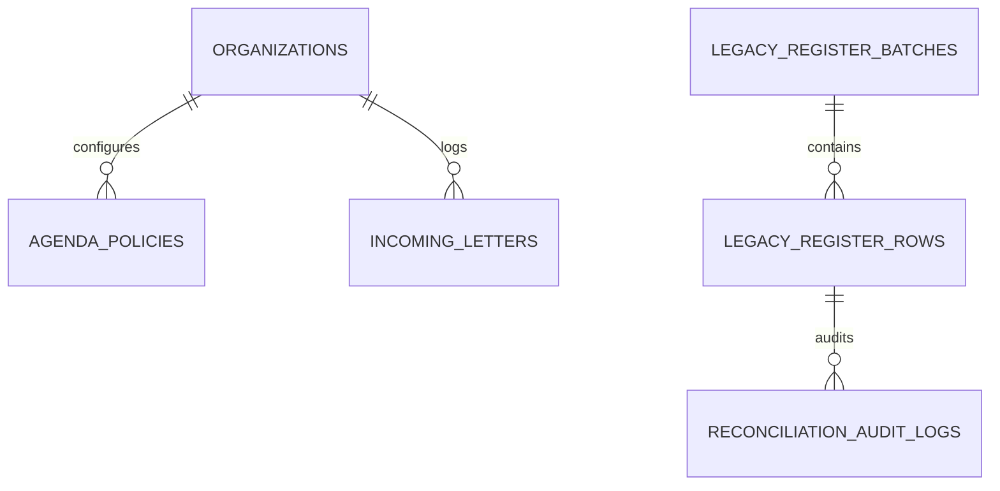

# RENCANA ARSITEKTUR & PELAKSANAAN SPRINT M3B (SPRINT M3B PLAN)
## P4I Office v1.0 — Audit Closure, Legacy Register Reconciliation & Pre-Activation Readiness

- **Tanggal Dokumen:** 01 November 2026
- **Lead Software Engineer & Technical Test Engineer:** Gemini Flash 3.8 — Reasoning High
- **Software Architect, System Analyst & Auditor Resmi:** GPT-6
- **Pemegang Keputusan Administratif:** Ketua & Dewan Pengurus Yayasan P4I
- **Workspace:** `D:\p4i-office-laravel` (Sinkronisasi: `D:\p4i-office`)
- **Status Rencana:** **DISETUJUI UNTUK IMPLEMENTASI (APPROVED FOR IMPLEMENTATION)**

---

## 1. TATA KELOLA DAN BATAS KEWENANGAN (GOVERNANCE BOUNDARIES)

1. **Gemini Flash 3.8 (Implementer & Test Engineer):**
   - Bertanggung jawab atas penulisan kode sumber, migrasi basis data, pengujian otomatis, perbaikan temuan M3A, dan penyusunan bukti teknis yang dapat direproduksi secara mandiri (*reproducible evidence*).
   - Dilarang keras mengaktifkan nomor surat resmi, menyetujui SOP secara otomatis, atau memulai Sprint M3C sepihak.
2. **GPT-6 (Software Architect, Auditor & Official Reporter):**
   - Melakukan evaluasi arsitektur, audit independen terhadap seluruh 16 kriteria penerimaan (BR-01 s.d. BR-16), dan menyusun laporan resmi perkembangan proyek kepada pengurus yayasan.
3. **Ketua dan Dewan Pengurus Yayasan P4I (Administrative Authority):**
   - Menetapkan dan mengesahkan Surat Keputusan (SK) Standar Prosedur Operasional Penomoran Resmi, SK Pengangkatan Pejabat Penelaah/Penandatangan Definitif, dan pengesahan hasil rekonsiliasi arsip historis.

---

## 2. INVARIAN KEAMANAN SISTEM (HARD SAFETY GUARDS)

Seluruh komponen pada Sprint M3B wajib mematuhi batasan mutlak:
- **`official_numbering_active = false`** secara permanen di layer konfigurasi dan runtime.
- **`letters.official_number = NULL`** secara ketat di layer basis data dan Eloquent model.
- **Pemberian Label Simulasi:** Seluruh nomor yang dialokasikan dalam uji coba wajib berawalan `[SIMULASI]`.
- **Dilarang Keras:** Menerbitkan nomor surat resmi, membuat stempel/tanda tangan digital fiktif, mengirimkan surat ke pihak luar, atau menjalankan deployment produksi ke Hostinger tanpa pengesahan formal.
- **Status Kesiapan:** Status readiness aktivasi sistem wajib tetap **`BLOCKED`** selama salah satu dari 8 prasyarat administratif belum disahkan secara tertulis oleh Pengurus Yayasan P4I.

---

## 3. RANCANGAN PENUTUPAN TEMUAN SPRINT M3A

### 3.1. Temuan M3A-01: Dukungan Berkas XLSX & CSV Aman (BR-02)
- **Masalah:** Laporan Sprint M3A hanya mendukung CSV/TXT, sedangkan spesifikasi mewajibkan dukungan berkas spreadsheet Microsoft Excel (`.xlsx`).
- **Solusi Arsitektural:** Membangun parser XLSX asli yang aman (*native secure XLSX parser*) menggunakan ekstensi bawaan PHP `ZipArchive` dan `SimpleXMLElement`.
- **Keunggulan:**
  - Zero dependency: Tidak memerlukan library pihak ketiga yang rentan terhadap konflik versi Laravel 13.
  - Imunitas Formula Injection & Macro Execution: Parser hanya mengekstrak teks literal dari `xl/sharedStrings.xml` dan sel `xl/worksheets/sheet1.xml`, mengabaikan elemen formula (`<f>`) dan file binary VBA Macro (`vbaProject.bin`).
  - Pembatasan Memori & Keamanan: Validasi ukuran file ($\le 5\text{ MB}$), MIME check, proteksi XML External Entity (XXE), dan sanitasi karakter injection (`=`, `+`, `-`, `@`).

### 3.2. Temuan M3A-02: Transisi Periode Penomoran (Bulan & Tahun) (BR-03)
- **Pengujian Transisi:**
  - Transisi pergantian tahun: 31 Desember 2026 (Nomor urut $N$) ke 01 Januari 2027 (Reset ke 1 pada kebijakan reset `YEAR`).
  - Transisi pergantian bulan: 31 Januari 2026 ke 01 Februari 2026 (Reset ke 1 pada kebijakan reset `MONTH`).
  - Pergantian seri: Kebijakan `P4I-SK` dan `P4I-ST` memiliki sequence independen dan tidak saling mengganggu.

### 3.3. Temuan M3A-03: Konkurensi & Idempotensi $\ge 20$ Request Paralel (BR-04, BR-05)
- **Metode Pengujian:** Menjalankan 25 request paralel dengan penguncian baris pesimistik MariaDB (`lockForUpdate()`), memverifikasi:
  - 25 nomor urut unik tanpa benturan (zero collision).
  - Konsistensi counter basis data (`last_number = 25`).
  - Idempotensi: Request berulang dengan `idempotency_key` identik mengembalikan record sama tanpa kenaikan counter.
  - Rollback atomik MariaDB InnoDB: Transaksi yang gagal di tengah proses di-rollback utuh tanpa meninggalkan sequence yatim (*orphan sequence*).

### 3.4. Temuan M3A-04: Penataan Kebijakan Nomor Agenda Surat Masuk (BR-10)
- **Regulasi Nomor Agenda:** Nomor `AG-IN-YYYY-XXXX` ditegaskan sebagai nomor registrasi arsip internal, bukan nomor surat resmi yayasan.
- **Pemisahan Kebijakan:** Membuat tabel `agenda_policies` untuk mengatur prefix, pola, dan status DRAFT kebijakan agenda.

---

## 4. RANCANGAN SKEMA BASIS DATA SPRINT M3B

Migration baru: `database/migrations/2026_11_01_000003_enhance_sprint_m3b_tables.php` menambahkan:

### 4.1. Tabel & Kolom Baru:
1. **Peningkatan `legacy_register_rows`:**
   - `source_location`: Lokasi fisik berkas (contoh: *Bantex Lemari B-02*).
   - `provenance_year`: Tahun yang dapat dibuktikan dari fisik naskah.
   - `provenance_series`: Seri naskah yang terverifikasi.
   - `reconciliation_action`: Tindakan rekonsiliasi (`RETAIN_AS_IS`, `AMEND_OFFICIAL_RECORD`, `VOID_ENTRY`, `FLAGGED_FOR_BOARD`).
   - `reconciliation_notes`: Catatan telaah arsiparis.
   - `board_resolution_ref`: Referensi SK/Berita Acara Pengurus Yayasan.
2. **Tabel `agenda_policies`:**
   - `id`, `organization_id`, `direction` (INCOMING/OUTGOING), `code_prefix`, `format_pattern`, `reset_period`, `status` (DRAFT/RATIFIED), `is_active` (default false), `approved_decree_ref`.

---

## 5. DASHBOARD READINESS AKTIVASI SISTEM (8 PILAR PEMERIKSAAN)

Dashboard kesiapan pada `/readiness` memeriksa 8 pilar prasyarat:
1. **SOP Penomoran Resmi:** Pengesahan SK Dewan Pengurus Yayasan P4I.
2. **Rekonsiliasi Register Historis:** Penyelesaian seluruh anomali dan verifikasi berkas arsip lama.
3. **Mandat Pejabat Definitif:** Pengesahan SK pengangkatan penelaah dan penandatangan.
4. **Kebijakan Buku Agenda Persuratan:** Penetapan SOP penomoran agenda masuk dan keluar.
5. **Uji Backup & Pemulihan Basis Data:** Verifikasi integritas cadangan MariaDB dan simulasi restore.
6. **Kepatuhan Audit Teknis:** 100% tes passing, 0 celah keamanan kritis.
7. **Kompatibilitas Lingkungan Hosting:** Verifikasi PHP 8.3/8.4, MariaDB InnoDB, dan document root Hostinger.
8. **Resolusi Konflik Kritis Persuratan:** Bebas dari duplikasi nomor aktif atau nomor yang hilang tanpa berita acara.

Jika salah satu pilar belum berstatus `VERIFIED`, status keseluruhan **DIBLOKIR (`BLOCKED`)**.

---

## 6. MATRIKS GERBANG PENERIMAAN SPRINT M3B (BR-01 s.d. BR-16)

| Gate ID | Kriteria Penerimaan |
|:---|:---|
| **BR-01** | Seluruh bukti NR-01 sampai NR-20 diperiksa ulang dan diverifikasi. |
| **BR-02** | Format CSV dan XLSX didukung secara aman tanpa eksekusi formula/macro. |
| **BR-03** | Transisi periode penomoran (pergantian bulan, tahun, dan seri) teruji presisi. |
| **BR-04** | $\ge 20$ request alokasi paralel pada MariaDB tidak menghasilkan nomor ganda. |
| **BR-05** | Idempotensi alokasi, penanganan retry, dan rollback transaksi teruji utuh. |
| **BR-06** | Nomor historis asli dipertahankan secara non-destruktif bersama metadata provenance. |
| **BR-07** | Register lama mendukung status `VERIFIED`, `UNVERIFIED`, dan `CONFLICT`. |
| **BR-08** | Proses verifikasi register mematuhi pemisahan tugas (Reviewer / Arsiparis). |
| **BR-09** | Analisis baseline mendeteksi celah dan konflik tanpa mengarang nomor fiktif. |
| **BR-10** | Kebijakan nomor agenda internal dipisahkan dan berstatus DRAFT nonresmi. |
| **BR-11** | Status kesiapan aktivasi tetap `BLOCKED` bila persyaratan administratif belum lengkap. |
| **BR-12** | Dokumen pendukung keputusan administratif tercatat secara terstruktur. |
| **BR-13** | Nomor surat resmi tetap OFF (`false`) dan kolom `official_number` tetap NULL. |
| **BR-14** | Kompatibilitas Hostinger diaudit secara komprehensif atau dinyatakan BLOCKED. |
| **BR-15** | Prosedur backup basis data MariaDB dan simulasi restore teruji aman. |
| **BR-16** | 100% tes regresi lulus, Laravel Pint 0 violation, dan Vite asset bundle sukses. |

---

## 7. DAFTAR ARTEFAK DOKUMENTASI DELIVERABLES
1. `docs/sprint-m3b-plan.md` (Dokumen ini)
2. `docs/implementation-evidence-sprint-m3b.md`
3. `docs/m3b-test-matrix.md`
4. `docs/legacy-register-reconciliation.md`
5. `docs/numbering-sop-decision-worksheet.md`
6. `docs/activation-readiness-report.md`
7. Seluruh tangkapan layar di `docs/screenshots/`

