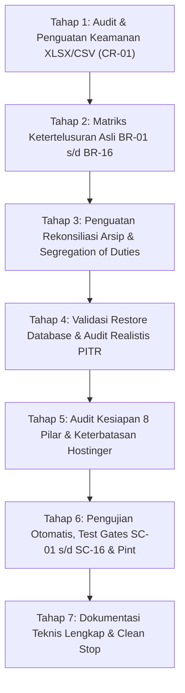

# RENCANA KERJA SPRINT M3C (SPRINT M3C PLAN)
## P4I Office v1.0: Security Hardening, Audit Closure & Pre-Production Verification

**Workspace:** `D:\p4i-office-laravel` (Sinkronisasi: `D:\p4i-office`)  
**Branch:** `feat/sprint-m3c-security-hardening`  
**Baseline Commit M3B:** `7890a66b355d8cd13b7bd498a2cbe72de4e9689e`  
**Implementer / Technical Test Engineer:** Gemini Flash 3.8 — Reasoning High  
**Software Architect, QA Auditor & Official Reporter:** GPT-6  
**Otoritas Administratif:** Ketua dan Dewan Pengurus Yayasan P4I  
**Target Deployment:** Hostinger Business Web Hosting

---

## 1. TUJUAN & RUANG LINGKUP SPRINT M3C

Sprint M3C difokuskan pada penyelesaian temuan kritis audit GPT-6 atas Sprint M3B, peningkatan keamanan parser spreadsheet (*Security Hardening*), verifikasi ketat ketertelusuran 16 gerbang penerimaan BR-01 s/d BR-16, penguatan pemisahan wewenang (*Segregation of Duties*) pada rekonsiliasi arsip historis, pengujian restorasi cadangan tanpa klaim palsu PITR, serta penegasan bahwa status operasional sistem tetap **`BLOCKED`** hingga keputusan administratif resmi disahkan oleh Yayasan P4I.

---

## 2. TAHAP KERJA SPRINT M3C

### Tahap 1: Audit dan Remediasi Keamanan Parser XLSX (Temuan CR-01)
- Audit mendalam pada `LegacyRegisterService`:
  - **Eliminasi `LIBXML_NOENT`:** Menghilangkan `LIBXML_NOENT`, `LIBXML_DTDLOAD`, `LIBXML_DTDVALID`.
  - **Penolakan DTD & Entity:** Memeriksa keberadaan `<!DOCTYPE` dan `<!ENTITY` sebelum XML diparsing; tolak dengan exception keamanan jika terdeteksi.
  - **Proteksi XXE:** Menggunakan secara ketat opsi `LIBXML_NONET` tanpa substitusi entitas.
  - **Proteksi ZIP Bomb & Konsumsi Sumber Daya:**
    - Batasi total berkas internal ZIP (maksimal 100 berkas).
    - Batasi ukuran hasil ekstraksi per berkas (maksimal 5 MB) dan ukuran kumulatif (maksimal 10 MB).
    - Periksa rasio kompresi (tolak jika rasio dekompresi > 100:1).
    - Batasi baris (maksimal 5.000 baris), kolom (maksimal 50 kolom), dan panjang karakter per sel (maksimal 1.000 karakter).
    - Audit path traversal pada nama entry ZIP (`../`, `..\`, atau path absolut).
  - **Penolakan Makro & Pranala Luar:**
    - Tolak berkas yang mengandung `xl/vbaProject.bin`, `customXml/`, atau relasi eksternal (`TargetMode="External"`).
  - **Pencegahan Formula Injection:**
    - Abaikan elemen `<f>`, sanitasi karakter awalan formula (`=`, `+`, `-`, `@`) pada seluruh sel teks.
  - **Pembuatan Test Fixtures Sintetis:**
    - Membuat fixture aman untuk menguji penolakan DTD, XXE, ZIP bomb, path traversal, macro, oversized cell, dan formula injection.

### Tahap 2: Matriks Ketertelusuran Akseptasi (Acceptance Traceability BR-01 s/d BR-16)
- Evaluasi ulang 16 Acceptance Gates BR-01 s/d BR-16 berdasarkan definisi asli Master Prompt Sprint M3B.
- Petakan ke: `Requirement ID -> Original Requirement -> Test Case -> Actual Result -> Evidence -> Status`.
- Tegaskan status `BLOCKED` atau `NOT VERIFIED` secara jujur untuk gerbang yang belum memiliki bukti administratif atau izin staging nyata.

### Tahap 3: Penguatan Rekonsiliasi Arsip & Segregation of Duties (SoD)
- Sempurnakan workflow aksi rekonsiliasi (`RETAIN_AS_IS`, `AMEND_OFFICIAL_RECORD`, `VOID_ENTRY`, `FLAGGED_FOR_BOARD`):
  - Model *Append-only*: Data mentah asli (`raw_number`, `source_location`) tidak boleh ditimpa.
  - Rekam identitas pengusul (`proposed_by`), pemeriksa/pengesah (`verified_by`), nomor dokumen dasar (`board_resolution_ref`), alasan, dan timestamp.
  - Terapkan aturan pencegahan *self-approval*: Pengusul koreksi tidak dapat mengesahkan usulannya sendiri.
  - Pisahkan secara eksplisit antara data seed ilustrasi (5 baris) dengan register asli fisik Yayasan P4I yang sebenarnya.

### Tahap 4: Validasi Restorasi Cadangan & Audit Realistis PITR
- Periksa `BackupRecoveryTest`:
  - Buktikan pemulihan ke database uji terpisah.
  - Catat metrik: jumlah tabel, jumlah baris, checksum, durasi pemulihan.
  - Buat penegasan teknis: Point-in-Time Recovery (PITR) berbasis binary log **`NOT SUPPORTED`** pada shared hosting Hostinger Business Web Hosting; pemulihan yang didukung adalah restorasi snapshot SQL dump terjadwal.

### Tahap 5: Audit 8 Pilar Kesiapan & Batasan Hostinger
- Audit implementasi `ReadinessService`:
  - Pertahankan status operasional **`BLOCKED`** (4/8 pilar).
  - Nyatakan pengujian lingkungan Hostinger produksi sebagai **`NOT VERIFIED / BLOCKED`** karena belum ada server staging resmi yang diizinkan pemilik.
  - Dokumentasikan analisis batasan teknis Hostinger (`CREATE TRIGGER` privilege, background worker, timeout FPM).

### Tahap 6: Eksekusi Test Suite & Kepatuhan Format Kode
- Jalankan seluruh suite tes pengujian otomatis (target > 85 tes passed).
- Jalankan Laravel Pint untuk memastikan 0 pelanggaran standar PSR-12.
- Jalankan build Vite frontend.

### Tahap 7: Dokumentasi Teknis & Clean Stop
- Susun 7 dokumen teknis dalam direktori `docs/` dan sinkronisasikan ke `D:\p4i-office`.
- Lakukan commit lokal pada branch `feat/sprint-m3c-security-hardening`.
- Hentikan pekerjaan (*Clean Stop Condition*) tanpa menyentuh penomoran resmi dan tanpa deployment.

---

## 3. IDENTIFIKASI RISIKO & MITIGASI

| Risiko | Dampak | Mitigasi |
| :--- | :--- | :--- |
| **Billion Laughs / Entity Expansion pada XLSX** | Server Denial of Service (DoS) dan pembacaan berkas lokal. | Hilangkan `LIBXML_NOENT`, gunakan `LIBXML_NONET`, tolak dokumen ber-DOCTYPE. |
| **ZIP Bomb pada Berkas XLSX** | Kehabisan memori / disk space pada Hostinger shared hosting. | Batasi total rasio kompresi, batas ukuran dekompresi kumulatif (10 MB), dan batas entry. |
| **Klaim Palsu Kemampuan PITR** | Harapan pemulihan bencana yang keliru bagi pengurus yayasan. | Nyatakan secara transparan bahwa PITR `NOT SUPPORTED` pada shared web hosting; andalkan snapshot harian. |
| **Konflik Kepentingan pada Rekonsiliasi Arsip** | Manipulasi data historis oleh staf atau teknisi tunggal. | Terapkan larangan *self-approval* dan penegasan bahwa teknisi tidak berwenang mengesahkan arsip. |
