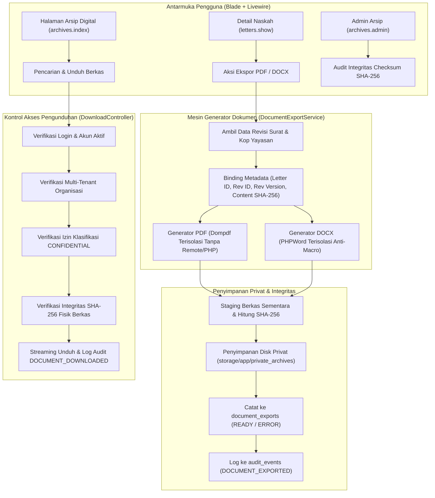

# RENCANA KERJA SPRINT M4A (SPRINT M4A PLAN)
## P4I Office v1.0: Document Export, Private Digital Archive & Integrity Verification

**Workspace:** `D:\p4i-office-laravel` (Tersinkronisasi ke `D:\p4i-office`)  
**Branch:** `feat/sprint-m4a-document-archive`  
**Baseline Commit M3C:** `f20a7cbbfff7d04ec98c8fb24059ee7b8d73bed2`  
**Implementer / Technical Test Engineer:** Gemini Flash 3.8 — Reasoning High  
**Software Architect, QA Auditor & Official Reporter:** GPT-6  
**Otoritas Administratif:** Ketua dan Dewan Pengurus Yayasan P4I  
**Target Deployment:** Hostinger Business Web Hosting

---

## 1. TUJUAN SPRINT M4A

Sprint M4A berfokus pada pembangunan mesin ekspor dokumen naskah dinas berformat **DRAF PDF** dan **DRAF DOCX**, sistem penyimpanan arsip digital privat (*Private Digital Archive*), verifikasi integritas berkas berbasis hash SHA-256, kontrol akses pengunduhan berbasis otorisasi dan klasifikasi kerahasiaan (*CONFIDENTIAL*), penandaan watermark *"DRAF — BELUM RESMI"* di setiap lembar dokumen, serta pencegahan berkas yatim (*orphan files*).

### Batasan Mutlak (*Hard Safety Invariants*):
- `official_numbering_active = false`
- `letters.official_number = NULL`
- Tidak ada nomor resmi yang diterbitkan, tidak ada status `ISSUED`, tidak ada tanda tangan digital ataupun stempel yayasan resmi.
- Status kesiapan persuratan yayasan secara keseluruhan tetap **`BLOCKED`**.

---

## 2. ARSITEKTUR TEKNIS & ALUR KERJA SPRINT M4A

---

## 3. RENCANA TAHAPAN PELAKSANAAN

### Tahap 1: Persiapan Skema Database & Storage Disk Privat
1. Konfigurasi disk privat `private_archives` pada `config/filesystems.php` mengarah ke `storage/app/private_archives` (di luar jangkauan direktori web publik `public/`).
2. Buat migrasi tabel `document_exports`:
   - `id` (UUID), `organization_id`, `letter_id`, `revision_id`, `revision_version`, `content_hash`, `format` (PDF/DOCX), `file_path`, `file_hash`, `file_size`, `mime_type`, `status` (`PENDING`, `READY`, `ERROR`), `idempotency_key`, `exported_by`, `error_message`, `download_count`, `last_downloaded_at`, `timestamps`.
3. Model Eloquent `App\Models\DocumentExport` dengan relasi ke `Letter`, `LetterRevision`, `User`, dan `Organization`.

### Tahap 2: Implementasi Mesin Render Dokumen (PDF & DOCX)
1. **Pustaka Pembuat:**
   - PDF: `Dompdf\Dompdf` versi 3.1.6 (Dikonfigurasi aman: `isRemoteEnabled = false`, `isPhpEnabled = false`, chroot terbatas).
   - DOCX: `PhpOffice\PhpWord` versi 1.4.0 (Dikonfigurasi aman: XML escaping, tanpa macro, tanpa external references).
2. **Kop & Format Surat Resmi P4I:**
   - Identitas Kop Surat Yayasan P4I (Gedung P4I, Jl. Pembangunan Nasional, Jakarta).
   - Data Surat: Nomor Draf `[SIMULASI] DRAF/P4I/...`, Tanggal, Perihal, Penerima, Isi Surat (hasil interpolasi templat aman), Nama Pejabat Mandat (dengan penanda Draf).
   - **Watermark Tegas:** *"DRAF — BELUM RESMI — TIDAK BERLAKU SEBAGAI SURAT KELUAR"* pada setiap halaman.
   - **Penafian Hukum:** Dokumen ini berstatus draf internal pra-aktivasi dan tidak sah sebagai surat dinas eksternal.

### Tahap 3: Manajemen Penyimpanan Privat & Pencegahan Berkas Yatim
1. Strategi transaksi 2-fase:
   - Buat record `document_exports` berstatus `PENDING` dengan `idempotency_key`.
   - Render ke berkas temporer di disk lokal privat.
   - Hitung hash SHA-256 dan ukuran byte.
   - Pindahkan ke jalur penyimpanan permanen: `{org_id}/{year}/{format}/{uuid}.{ext}`.
   - Perbarui record menjadi `READY`.
   - Jika terjadi exception/gagal: hapus berkas sementara, tandai record `ERROR`, catat audit event kegagalan.

### Tahap 4: Pengunduhan Terproteksi & Penegakan Izin
1. Rute pengunduhan: `GET /archives/{export}/download`.
2. Otorisasi ketat:
   - Autentikasi pengguna aktif.
   - Isolasi organisasi (pengguna organisasi A dilarang mengunduh dokumen organisasi B).
   - Perlindungan dokumen `CONFIDENTIAL`: Hanya konseptor, penelaah aktif, atau pengurus/admin yang dapat mengunduh.
   - Pencegahan Path Traversal: Berkas dibaca strictly melalui `file_path` yang tersimpan di database, bukan dari input parameter browser.
   - Pemeriksaan integritas checksum SHA-256 sebelum file distreaming ke browser.
   - Pencatatan event audit `DOCUMENT_DOWNLOADED`.

### Tahap 5: Antarmuka Pengguna (Blade, Livewire, Tailwind CSS)
1. **Detail Surat (`letters.show`):** Tombol unduh draf PDF dan DOCX, tabel riwayat ekspor lengkap dengan versi revisi, pembuat, tanggal, dan status.
2. **Arsip Digital (`/archives`):** Daftar seluruh dokumen draf yang pernah diekspor, pencarian perihal/nomor, filter jenis surat, status, tanggal, dan tombol unduh.
3. **Admin Arsip (`/archives/admin`):** Statistik kapasitas arsip privat, tombol verifikasi integritas checksum SHA-256 berkala, log riwayat pengunduhan.

### Tahap 6: Pengujian Otomatis & Kepatuhan Gerbang M4A-01 s/d M4A-18
1. Pengujian fitur lengkap pada `tests/Feature/DocumentExportWorkflowTest.php` dan `tests/Feature/PrivateArchiveSecurityTest.php`.
2. Uji backup dan restore arsip dokumen dan basis data terisolasi.
3. Eksekusi Laravel Pint (PSR-12), Vite build, dan tangkapan layar browser headless.

### Tahap 7: Dokumentasi Teknis & Clean Stop
1. Susun seluruh 6 dokumen teknis di `docs/` dan sinkronisasikan ke `D:\p4i-office`.
2. Commit lokal aman pada branch `feat/sprint-m4a-document-archive`.
3. Penghentian kerja bersih (*Clean Stop*).

---

## 4. MATRIKS RISIKO & MITIGASI SPRINT M4A

| Risiko | Dampak | Strategi Mitigasi |
| :--- | :--- | :--- |
| **Server-Side Request Forgery (SSRF) via PDF** | Penyerang menyisipkan tag `` pada isi surat untuk mencuri metadata server. | Nonaktifkan opsi `isRemoteEnabled` pada Dompdf (`false`). Chroot dibatasi pada direktori lokal aset aplikasi. |
| **Penyalahgunaan Dokumen Draf sebagai Surat Resmi** | Surat draf dicetak atau diedarkan ke instansi mitra seolah-olah surat resmi. | Watermark *"DRAF — BELUM RESMI"* disematkan di setiap lembar; penafian hukum dicetak tebal; nomor surat tetap NULL/DRAF. |
| **Kebocoran Dokumen Rahasia (CONFIDENTIAL)** | Staf umum mengunduh naskah internal berklasifikasi rahasia. | Policy controller memverifikasi klasifikasi surat: dokumen CONFIDENTIAL dibatasi hanya untuk pembuat dan penelaah berwenang. |
| **Berkas Yatim (Orphan Files)** | Kegagalan penyimpanan menghasilkan berkas fisik tanpa record DB, atau record DB berstatus READY tanpa berkas fisik. | Pola staging temporer, validasi integritas pra-finalisasi, rollback file pada blok catch. |
| **Inkonsistensi Revisi pada Ekspor Dokumen** | Dokumen lama dikira berasal dari revisi terbaru padahal naskah telah diubah. | Record ekspor mengikat `revision_id` dan `revision_version` secara eksplisit; UI menampilkan penanda versi revisi. |
